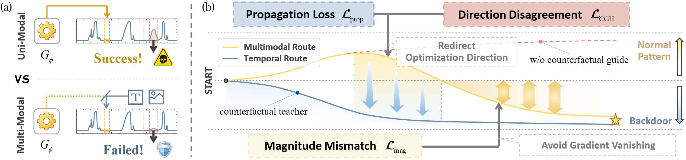
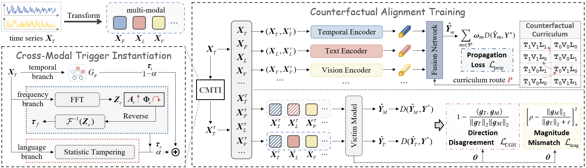
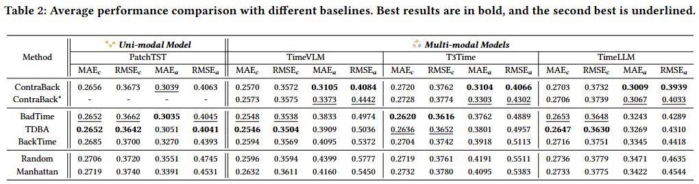

<p align="center">
  
</p>
<h1 align="center">When Triggers Lose Their Route: Counterfactual Backdoor Learning for Multi-Modal Time Series Forecasting</h1>
<h3 align="center">🎉 Submitted to WWW 2027 🎉</h3>

---


## 🔧 Basic Information
We reveal that existing temporal backdoors are substantially weakened in multi-modal time series models. The trigger is
attenuated during modality transformation, while the surviving temporal signal is further disrupted by asymmetric conflict.

We propose **ContraBack**, a counterfactual guided backdoor framework for multi-modal time series forecasting. 
ContraBack reconstructs temporal triggers into persistent cross-modal malicious concepts and further aligns multi-modal
backdoor learning with the effective temporal attack trajectory, stabilizing the trigger-target association under multi-modal
fusion.

## 📐 The Overall Framework


Its architecture is built upon two key innovations: 
1) **Cross-Modal Persistent Trigger Instantiation**. we reverse-engineer the trigger construction through the evolution of time series modality to generate a transferable trigger carrier across modalities. 
This step establishes a stable trigger signal and lays the foundation for counterfactual route construction. 
2) **Counterfactual Alignment Training**. we first align propagation across different modalities and employ a counterfactual
curriculum to guide each modality's contribution to the backdoor. We then introduce a counterfactual gradient harmonization 
strategy to simultaneously resolve cross-modal gradient direction conflicts and magnitude suppression.

## 📁 Project Structure

```
GridTroj/
│───README.md                             # Project documentation
│───requirements.txt                      # Python dependencies
│───attack.py                             # Backdoor attack logic
│───dataset.py                            # Data loading and preprocessing
│───run.py                                # Main training entry point
│───timefeatures.py                       # Datetime feature encoding
│───trainer.py                            # Training loop
│───trigger.py                            # Trigger generator
│───trigger_locator.py                    # Attention-based trigger segment locator
│───configs/ 
│   │───default_config.yaml               # Model and dataset configurations
│   └───train_config.yaml                 # Training / attack hyperparameters
│───data/                                 # Dataset directory
│   │───xx.csv                            # Raw time series data
│   └───...
│───forecast_models/                      # Forecasting backbones
│   │───layers/                           # Shared Transformer component
│   │───Autoformer.py                     # Autoformer
│   └───...
│───pretrained_models/
│   │───clip-vit-base-patch32/            # Pretrained CLIP for image modality
│   │───gpt2/                             # Pretrained gpt2 for text modality
└───...
```

## 🚀 Quick Start

Run `run.py`.
We offer flexible parameter configurations: use the `--model_name` parameter to select
different forecasting backbone. Set `--use_trigger_carrier` to *true* to enable cross-modal trigger.

Download the following datasets from https://github.com/thuml/Time-Series-Library and place them in the `data/` directory:
- `electricity.csv`
- `ETTm1.csv`
- `ETTm2.csv`
- `ETTh1.csv`
- ...

The ckpt will be saved in the `checkpoints/` directory as `.pth` files.

> **Note**:  
> - Make sure you have properly turn on `--use_trigger_carrier`, whenever attacking unimodal models or multimodal models.
> - This repository contains code for review purposes. The complete implementation will be released upon paper acceptance. 

## 📊 Experiment Results


WWe conduct extensive experiments on unimodal and multi-modal forecasting models across ten datasets. Across diverse multi-modal
TSF models, ContraBack substantially improves attack performance, reducing attack error by 23.7% on average.

---

<p align="center">✨ Thank you for exploring ContraBack. Together, let's build a robust future! ✨</p>